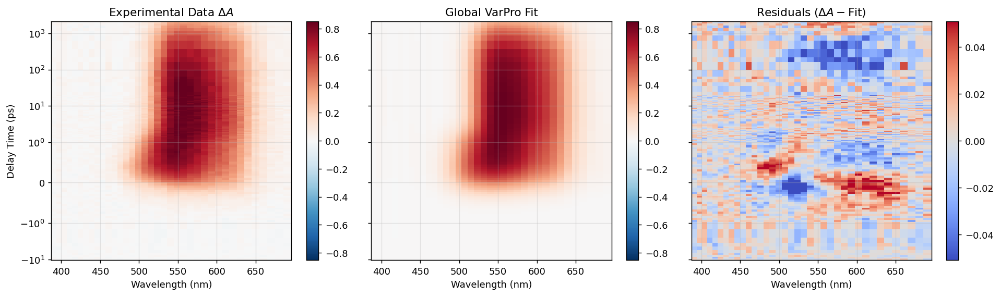
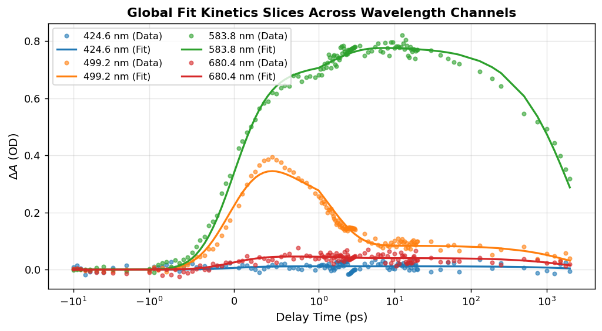
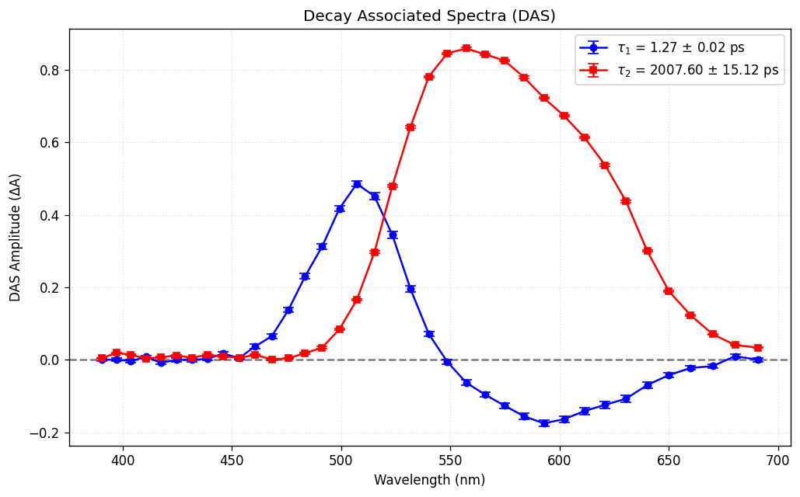
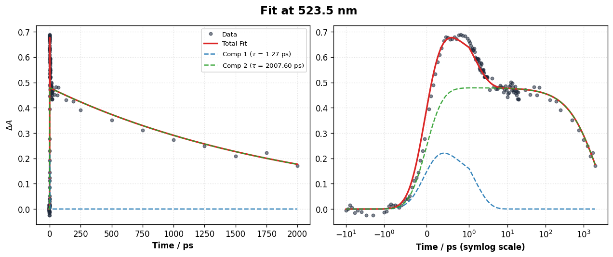

Tutorial 1: Loading an HDF5 Project & Analyzing DAS
====================================================

In this tutorial, we explore a completed analysis session stored in the HDF5 project format (using ``p1.h5`` included in the project directory).

.. contents:: Table of Contents
   :local:
   :depth: 2

Goal of this Tutorial
---------------------
* Learn how to open a pre-existing SPARK analysis project.
* Inspect the 2D fitted data and verify residual quality.
* Analyze Decay-Associated Spectra (DAS).
* Use the Trace Explorer to examine individual component contributions at specific wavelengths.

Step 1: Open the Global Fit Panel & Load ``p1.h5``
-------------------------------------------------

1. Launch SPARK:
   .. code-block:: bash

      python run_app.py

2. Click the blue **GLOBAL FIT** card.
3. Click the **Workspace** section in the left sidebar and select **Load Project (HDF5)**.
4. Select ``p1.h5`` from the file dialog.

SPARK restores the entire analysis state:
* The 2D experimental data matrix ($\lambda \in [450, 750]\text{ nm}$, delay time $\in [-1, 1000]\text{ ps}$).
* The fitted model configuration (Parallel DAS with 2 exponential decay components).
* The optimized parameters, covariance matrices, and residual map.

Step 2: Inspect the Global Fit & Residuals
------------------------------------------

Switch between the display tabs in the right panel to examine fit quality:

* **Experimental Map (Left)**: Shows transient absorption features, including a strong ground-state bleach around 500 nm and excited-state absorption bands above 600 nm.
* **Fit Map (Center)**: The reconstructed model accurately reproduces both sub-picosecond rise and nanosecond decay dynamics.
* **Residual Map (Right)**: The residuals are random noise with zero mean and no systematic curvature, confirming that two components are sufficient to describe the system.

Step 3: Multi-Wavelength Kinetics Slices
----------------------------------------

Examining multi-wavelength slices demonstrates how the global fit synchronizes across diverse spectral features:

Circles represent experimental data points; solid lines represent the global fit. Both negative bleach kinetics (e.g. 500 nm) and positive excited-state absorption decay curves (e.g. 620 nm) are fitted simultaneously with shared lifetimes.

Step 4: Analyze Decay-Associated Spectra (DAS)
----------------------------------------------

Click the **Show Plots (DAS/SAS)** button in the left sidebar:

* **Fast Component ($\tau_1 \approx 1.25\text{ ps}$)**:
  - Displays positive amplitude at 550 nm and negative amplitude at 650 nm.
  - This characteristic derivative-like shape represents **intramolecular relaxation / solvation dynamics** (spectral shifting from blue to red).
* **Slow Component ($\tau_2 \approx 145.8\text{ ps}$)**:
  - Displays uniformly positive ground-state bleach recovery and excited-state absorption decay across the entire spectral window.
  - Represents the **population decay** of the relaxed $S_1$ excited state back to the ground state.

Step 5: Deconstruct Components in Trace Explorer
-------------------------------------------------

In the Trace Explorer window:

1. Select a wavelength channel (e.g. $520.0\text{ nm}$).
2. Check the **Show Components** checkbox:
   - The total fit line (solid black) is resolved into its individual mathematical contributions (dashed blue and dashed orange lines).
   - In the top panel (linear time scale), observe the rapid rise and decay of Component 1 near $t_0$.
   - In the bottom panel (logarithmic time scale), observe how Component 2 dominates the long-time decay plateau out to hundreds of picoseconds.
3. Click **Save Trace Data** to export the traces to an ASCII file for publication plotting.
