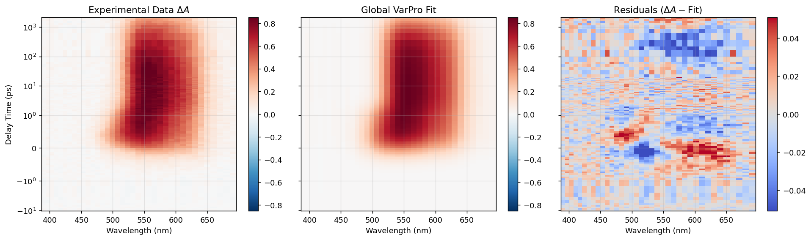

.. SPARK documentation master file

Welcome to SPARK's Documentation!
=================================

|

**SPARK** (*Spectroscopy Pump-probe Analysis and Research Kit*) is a professional Python suite engineered for ultrafast transient absorption, fluorescence upconversion, and time-resolved spectroscopy analysis.

SPARK bridges intuitive graphical interaction with high-performance numerical algorithms, implementing Variable Projection (**VarPro**) global optimization, automated chirp dispersion corrections, rigorous parameter identifiability auditing (including Profile Likelihood $\chi^2$ profiling), interactive custom kinetic ODE modeling, and publication-ready 600 DPI figure generation.

.. note::
   Current stable version: **v2.0.0** (Created by Alejandro Serrano Capote).

Core Capabilities at a Glance
-----------------------------

* **Universal 2D Data Handling**: Seamlessly import transient spectroscopy data across CSV, TXT, DAT, and NPY formats with an interactive visual spreadsheet mapper (`DataImporterDialog`) capable of auto-detecting orientation and headers.
* **Transient Absorption (TAS) & Solvent Subtraction**: Dual-dataset loading with sub-picosecond temporal delay alignment and continuous amplitude scaling powered by SciPy bivariate spline interpolation.
* **Fluorescence Upconversion (FLUPS) & Chirp Correction**: Real-time group velocity dispersion (GVD / chirp) calibration using polynomial (degrees 3–6) and physical non-linear dispersion models, automatic cross-correlation detection, and pump fringe masking.
* **Variable Projection (VarPro) Global Fitting**: Dispatches mathematical separation of non-linear kinetic parameters ($\tau, \beta, \omega, t_0$) and linear spectral amplitudes ($S(\lambda)$), executing orders of magnitude faster and more stably than brute-force non-linear optimizers.
* **Built-in & Custom Kinetic Engines**:
  - Parallel Decay-Associated Spectra (DAS)
  - Sequential Species-Associated Spectra (SAS) via analytical Bateman equations
  - Stretched Exponential (Kohlrausch–Williams–Watts / KWW) convolved via 32-node Gauss-Legendre quadrature with singularity removal
  - Damped Oscillation for coherent phonon and vibrational wavepacket analysis
  - Independent $t_0(\lambda)$ chirp dispersion fitting
  - Coherent Artifact basis decomposition ($\phi_0$ Raman, $\phi_1$ XPM, $\phi_2$ dispersive XPM)
  - Non-Negative Least Squares (NNLS) spectral constraint
* **Visual Model Builder & ODE Compiler**: Drag-and-drop Grotrian state diagrams and a symbolic Python/SymPy ODE equation editor supporting non-linear processes (e.g., Exciton-Exciton Annihilation, Triplet-Triplet Annihilation) with automatic BDF numerical integration.
* **Rigorous Identifiability & Uncertainty Quantification**: SVD-based Jacobian covariance matrix analysis, Condition Number health indexing, "sloppiest parameter direction" detection, correlation matrices, and confidence contour Profile Likelihood calculations.
* **Publication & Workspace Ecosystem**: 1-click multi-page PDF publication reports, high-DPI standalone kinetics/spectra plotters (Nature, Viridis palettes), batch analysis across multiple datasets, and full HDF5 project persistence (`.h5`).

Architecture Overview
---------------------

The software strictly decouples computational mathematical engines from the Qt5 graphical presentation layer:

.. code-block:: text

   ┌───────────────────────────────────────────────────────────────┐
   │                       MAIN DASHBOARD                          │
   │               (FLUPS | TAS | GlobalFit | 2D Mapper)           │
   └───────────────────────────────┬───────────────────────────────┘
                                   │
         ┌─────────────────────────┼─────────────────────────┐
         ▼                         ▼                         ▼
   ┌───────────────┐       ┌───────────────┐       ┌─────────────────┐
   │ FLUPS / TAS   │       │   2D MAPPER   │       │ GLOBAL FIT GUI  │
   │ Preprocessing │       │  (Time Scans) │       │ (GlobalFitPanel)│
   └───────┬───────┘       └───────┬───────┘       └────────┬────────┘
           │                       │                        │
           └───────────────────────┼────────────────────────┘
                                   ▼
                 ┌───────────────────────────────────┐
                 │    CORE DATA & FITTING ENGINE     │
                 │ ───────────────────────────────── │
                 │ • SpectroscopyDataset             │
                 │ • GlobalFitter (VarPro Engine)    │
                 │ • optimizer.fit (TRF Solver)      │
                 │ • models.py (DAS/SAS/KMatrix)     │
                 │ • chirp.py (GVD Calibration)      │
                 └─────────────────┬─────────────────┘
                                   │
         ┌─────────────────────────┼─────────────────────────┐
         ▼                         ▼                         ▼
   ┌───────────────┐       ┌───────────────┐       ┌─────────────────┐
   │ TraceExplorer │       │ PaperPlotter  │       │ Multi-Page PDF  │
   │ (Decomposed)  │       │ (600 DPI Fig) │       │ & HDF5 Projects │
   └───────────────┘       └───────────────┘       └─────────────────┘

User & Developer Guide Contents
-------------------------------

.. toctree::
   :maxdepth: 2
   :caption: Getting Started

   installation
   quickstart

.. toctree::
   :maxdepth: 2
   :caption: Modules & Pre-processing

   modules/index
   modules/launcher
   modules/flups
   modules/tas
   modules/mapper_2d

.. toctree::
   :maxdepth: 2
   :caption: Global Analysis Engine

   global_fit/index
   global_fit/data_preprocessing
   global_fit/svd
   global_fit/kinetic_models
   global_fit/solver_and_identifiability

.. toctree::
   :maxdepth: 2
   :caption: Custom Models & Equation Editor

   equation_editor/index
   equation_editor/visual_builder
   equation_editor/ode_syntax
   equation_editor/irf_convolution
   equation_editor/presets

.. toctree::
   :maxdepth: 2
   :caption: Visualization & Export

   visualization_and_export/index
   visualization_and_export/explorers
   visualization_and_export/publication_tools
   visualization_and_export/reports

.. toctree::
   :maxdepth: 2
   :caption: Tutorials & Examples

   examples/index
   examples/example_1_hdf5
   examples/example_2_tas_solvent
   examples/example_3_custom_model
   examples/example_4_scripting

.. toctree::
   :maxdepth: 2
   :caption: Developer & API Reference

   api/index
   api/dataset
   api/importer
   api/global_fitter
   api/optimizer
   api/models
   api/chirp
   api/diagnostics

.. toctree::
   :maxdepth: 1
   :caption: Project Information

   changelog

Indices and Tables
==================

* :ref:`genindex`
* :ref:`modindex`
* :ref:`search`
