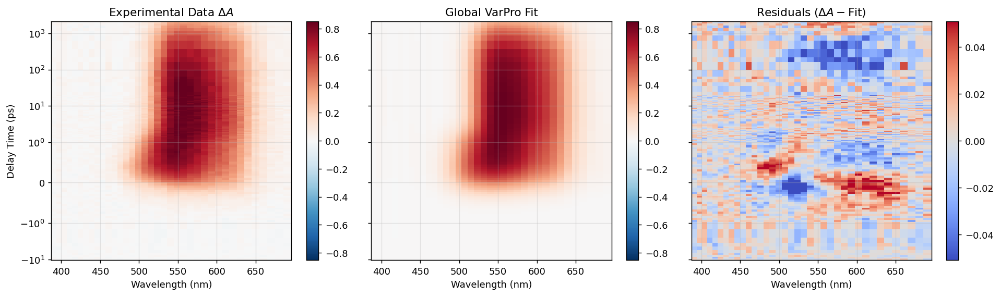

Quick Start: 5-Minute Tutorial
==============================

This walkthrough guides you through loading a spectroscopy dataset, running a Global Variable Projection fit, inspecting individual kinetic components, and generating publication plots in under five minutes.

.. contents:: Steps
   :local:
   :depth: 1

Step 1: Launch the Main Dashboard
---------------------------------

Launch SPARK via your desktop shortcut or run ``python run_app.py``. You will be greeted by the central launcher hub:

.. code-block:: text

   ┌────────────────────────────────────────────────────────────────────────┐
   │  S.P.A.R.K.  │  PRIMARY PROCESSING MODULES                             │
   │              │  ┌────────────────────────┐  ┌────────────────────────┐ │
   │  Spectroscopy│  │     FLUPS ANALYZER     │  │      TAS ANALYZER      │ │
   │  Pump-probe  │  │  Chirp & Fringe Fixes  │  │  Solvent Subtraction   │ │
   │  Analysis &  │  └────────────────────────┘  └────────────────────────┘ │
   │  Research    │  ADVANCED ANALYSIS & VISUALIZATION                      │
   │  Kit         │  ┌────────────────────────┐  ┌────────────────────────┐ │
   │              │  │       GLOBAL FIT       │  │       2D MAPPER        │ │
   │  v2.0.0      │  │  Multi-Model VarPro    │  │  XFEL Time Scans       │ │
   │              │  └────────────────────────┘  └────────────────────────┘ │
   └────────────────────────────────────────────────────────────────────────┘

Click the blue **GLOBAL FIT** card to open the analysis workstation.

Step 2: Load Project Data
-------------------------

In the Global Fit panel:

1. Click the **Workspace** section or click **Load Project (HDF5)**.
2. Select an existing ``.h5`` project file (for example, the included ``p1.h5``).
3. The dataset automatically populates across the Raw Data canvas with:
   - Full 2D heatmap ($\lambda$ on X-axis, delay time on Y-axis).
   - Bottom-left marginal kinetics trace (slice at cursor wavelength).
   - Bottom-right marginal spectrum trace (slice at cursor time delay).

.. tip::
   Move your mouse across the 2D map: SPARK uses a high-performance **blitting engine** that redraws crosshairs and marginal curves at ~60 frames per second without lagging.

Step 3: Configure Kinetic Model
-------------------------------

Switch to the **Fit** tab on the left control sidebar:

1. **Number of Components**: Set ``Number of Exp: 2``.
2. **Model Selection**: Select ``Parallel`` (Decay-Associated Spectra, DAS).
3. **Artifact Correction**: Check ``Fit Coherent Artifact`` if your data has solvent Raman or cross-phase modulation around $t_0$.
4. **Initial Guesses**: Click **Edit Initial Guesses** if you want to inspect or constrain starting lifetimes ($\tau_1, \tau_2$), the IRF width ($w$), or time-zero ($t_0$). Otherwise, SPARK's automatic heuristic generator configures robust defaults based on your time axis range.

Step 4: Run the Global VarPro Fit
---------------------------------

Click the green **RUN FIT** button:

* A progress bar appears at the bottom.
* SPARK's background worker thread executes the **Variable Projection** algorithm:
  - In each iteration, non-linear parameters ($\tau_1, \tau_2, w, t_0$) are proposed by the Trust-Region Reflective (TRF) optimizer.
  - Linear spectral amplitudes $S(\lambda)$ are determined instantaneously via singular value least-squares ($C^+ \cdot D$).
  - When the fit converges (typically within 1–3 seconds), a notification appears and all canvases update immediately.

Step 5: Inspect Fit Quality and Residuals
-----------------------------------------

Once fitted, switch between the viewer tabs in the right panel:

* **Raw Data**: Preprocessed experimental $\Delta A(\lambda, t)$.
* **Fit Result**: The reconstructed model $D_{\text{fit}} = C \cdot S^T$.
* **Residuals**: The difference map $R = D - D_{\text{fit}}$. Notice how the residuals are random noise without systematic diagonal streaks, confirming an accurate fit.

Step 6: Visualize DAS & Decomposed Kinetics
--------------------------------------------

Click the **Show Plots (DAS/SAS)** button:

1. **Decay-Associated Spectra Window**:

   .. image:: _static/images/das_spectra_example.png
      :alt: DAS Spectra with Lifetimes
      :align: center
      :width: 80%

   Each component spectrum is plotted with its fitted lifetime and uncertainty in the legend (e.g., $\tau_1 = 1.25 \pm 0.04\text{ ps}$, $\tau_2 = 145.8 \pm 3.2\text{ ps}$).

2. **Interactive Trace Explorer Window**:

   .. image:: _static/images/trace_explorer_example.png
      :alt: Trace Explorer with Component Decomposition
      :align: center
      :width: 85%

   - Select any wavelength channel from the dropdown.
   - Check **Show Components** to view the individual kinetic contributions (dashed colored lines) alongside the experimental data (points) and total fit (solid black line) on both linear and logarithmic time axes.

Step 7: Generate Publication PDF Report
----------------------------------------

Click **Export PDF Report** in the left sidebar:

SPARK generates a publication-grade, multi-page vector PDF containing:
1. Complete parameter table ($\tau_i$, errors, $w$, $t_0$, RMSD).
2. Parameter Identifiability and correlation matrix.
3. 2D triplet maps (Data, Fit, Residuals).
4. DAS/SAS spectra with error bars.
5. Representative multi-wavelength kinetics slices.
6. SVD singular value scree analysis.
