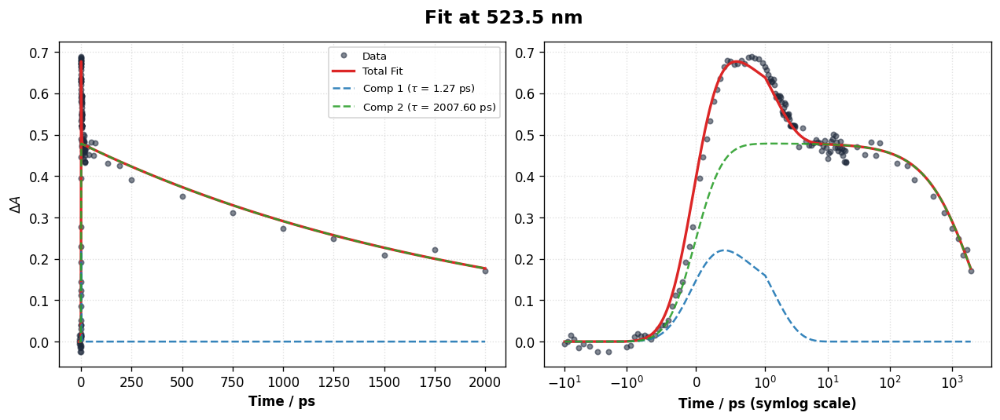

Interactive Data Explorers
===========================

SPARK includes specialized non-modal viewer windows implemented in ``spark/gui/plotters/explorers.py`` for in-depth data inspection.

.. contents:: Table of Contents
   :local:
   :depth: 2

Trace Explorer (`TraceExplorerWindow`)
--------------------------------------

The **Trace Explorer** is opened via the **Show Plots** action or the Results menu. It provides an interactive inspection environment for kinetics traces at any chosen wavelength channel.

Key Features:
* **Dual-Panel Architecture**:
  - **Top Panel (Linear Time Scale)**: Focuses on sub-picosecond dynamics, the Gaussian IRF rise, time-zero shift, and fast coherent artifact oscillations.
  - **Bottom Panel (SymLog Time Scale)**: Displays dynamics spanning femtoseconds to nanoseconds on a logarithmic time axis with a linear transition threshold (typically $[-1, 1]\text{ ps}$).
* **Wavelength Channel Selector**: Choose any wavelength from the dropdown or cycle through spectral bands using arrow keys.
* **Component Decomposition ("Show Components" Checkbox)**:
  - When checked, SPARK decomposes the total fit curve into its constituent kinetic components.
  - Each physical component is drawn as a distinct dashed line in its own color.
  - If a coherent artifact (Raman or XPM) is included in the model, its isolated temporal response is overlaid at early times.
  - The legend displays the fitted lifetime for each individual component using proper mathematical Greek symbols ($\tau_1, \tau_2, \dots, \beta$).
* **Exporting Trace Slices**: Click **Save Trace Data** to export the displayed kinetics curve as a publication-ready ASCII file containing columns: ``[Delay_Time, Experimental_Data, Total_Fit, Component_1, Component_2, ...]`` along with a high-resolution PNG image.

3D Surface Explorer (`Surface3DWindow`)
---------------------------------------

Click **3D Surface** in `GlobalFitPanel` to launch the 3D elevation viewer:

* **Interactive Perspective**: Click and drag with the left mouse button to rotate the 3D surface around any spatial axis; use the right mouse button to zoom.
* **SymLog Elevation**: The vertical intensity axis ($\Delta A$) supports symmetric logarithmic scaling, allowing weak nanosecond signals to remain visible alongside intense sub-picosecond peaks without saturation.
* **Wall Projections**: The bounding back walls of the 3D box display projected marginal slices:
  - Back-left wall: Integrated kinetics decay slice.
  - Back-right wall: Integrated emission/absorption spectrum slice.

Generic Plot Viewer (`PlotViewerWindow`)
----------------------------------------

A standalone window for reviewing static figures (such as DAS/SAS spectra or 2D residual maps). Equipped with the full Matplotlib `NavigationToolbar`, enabling pan, zoom, sub-region box zoom, and vector export (PDF, EPS, SVG).
