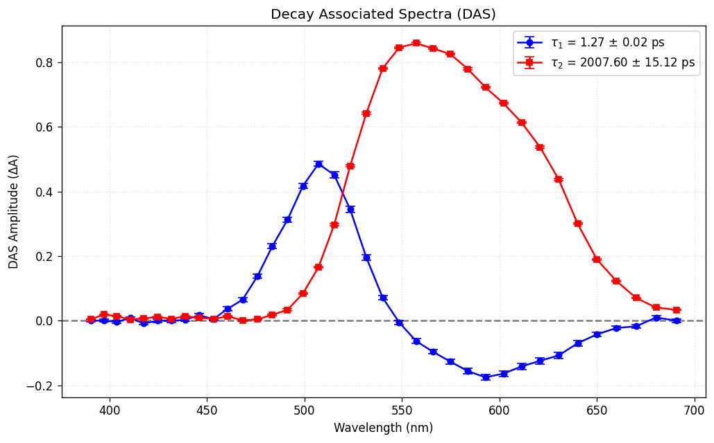

Publication Plotters (600 DPI)
===============================

Creating figures for peer-reviewed journals (Nature, JACS, ACS Nano, Physical Review) often requires fine-tuning font sizes, aspect ratios, color palettes, and error bars. SPARK includes two dedicated standalone publication designers implemented in ``spark/gui/plotters/publication.py``.

.. contents:: Table of Contents
   :local:
   :depth: 2

PaperPlotter (Kinetics Designer)
--------------------------------

Launched from the **Export** tab or the Trace Explorer, ``PaperPlotterWindow`` is a drag-and-drop figure composition tool for time-resolved decay curves.

.. code-block:: text

   ┌────────────────────────────────────────────────────────────────────────┐
   │  PaperPlotter - Publication Kinetics Designer                          │
   ├───────────────────────────────────────────────────────┬────────────────┤
   │  [ Drop .txt trace files here ]                       │ Canvas Preview │
   │                                                       │                │
   │  Styling Controls:                                    │  ▲ ΔA          │
   │  • Palette: [ Nature ▼ ] (Nature / Viridis / Plasma)  │  │   ●   Fit   │
   │  • Dimensions: Width [ 3.5 ] in  Height [ 2.8 ] in    │  │  ● ●  ───   │
   │  • Scale: [ SymLog ▼ ]  Linthresh [ 1.0 ] ps          │  │ ●   ●       │
   │  • [X] Hide Negative Times   [ ] Normalize Traces     │  └──────────►  │
   │                                                       │       Time (ps)│
   │  Legend & Labels Table:                               │                │
   │  Trace 1: "480 nm (Bleach)"  | Color: #1f77b4         │                │
   │  Trace 2: "620 nm (ESA)"     | Color: #ff7f0e         │                │
   │                                                       │                │
   │  [ Export Figure (600 DPI) ]  [ Clear Data ]          │                │
   └───────────────────────────────────────────────────────┴────────────────┘

Key Capabilities:
* **Drag-and-Drop Ingestion**: Drag exported trace text files from Windows Explorer directly into the window. SPARK parses the headers, identifies wavelength channels, and separates experimental data from global fit curves.
* **Curated Scientific Palettes**: Select from publication color palettes:
  - ``Nature``: High-contrast colorway optimized for Nature and Science group journals.
  - ``Viridis`` / ``Plasma``: Perceptually uniform, colorblind-friendly scientific scales.
  - ``Set1`` / ``Tab10``: Classic distinct categorical hues.
* **Figure Dimensions**: Specify physical output size in inches (e.g. single-column standard $3.5\text{ in}$ width or double-column $7.0\text{ in}$ width).
* **High-DPI Export**: Click **Export Figure** to render at **600 DPI** in vector PDF, lossless TIFF, or high-resolution PNG.

SASDASPlotter (Spectra Designer)
--------------------------------

``SASDASPlotterWindow`` is designed specifically for Decay-Associated Spectra (DAS) and Species-Associated Spectra (SAS).

Key Capabilities:
* **Drag-and-Drop Spectral Input**: Drag ``Amplitudes.txt`` or individual spectrum files into the drop zone.
* **Error Bar Formatting**: Adjust marker sizes, line widths, and error cap sizes (`spin_cap`) to ensure error bars are readable in print.
* **LaTeX Legend Strings**: Legends automatically format mathematical notation with Greek letters ($\tau_i$, $\beta_i$) and uncertainties ($\pm$).
* **Direct Axis Control**: Switch between automatic limits and precise manual ranges ($[\lambda_{\min}, \lambda_{\max}]$ and $[S_{\min}, S_{\max}]$).
* **Zero Baseline Reference**: Includes a clean, dashed zero-line for distinguishing positive excited-state absorption (ESA) from negative ground-state bleach (GSB) or stimulated emission (SE).
